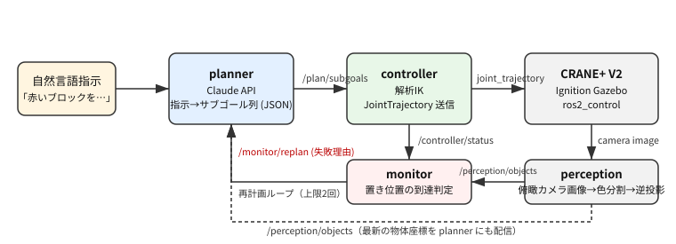
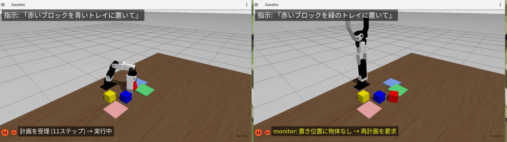

# AI×ロボティクス: 自然言語指示による CRANE+ V2 のピック&プレース

**LLM プランナーと閉ループ再計画による創造的タスクの実現（Physical AI応用1講座 最終課題）**

## 1. 課題の概要と目的

自然言語の指示（例:「赤いブロックを青いトレイに置いて」）だけで卓上アーム CRANE+ V2 にピック&プレースを行わせるシステムを、
講義環境（ROS 2 Humble + Ignition Gazebo Fortress）上に構築した。LLM（Claude）は指示を**サブゴール列**に翻訳する役割に限定し、
実際の運動は解析的な逆運動学（IK）で生成する。実行後に物体位置を再観測して目標未達なら LLM に**再計画**を求める閉ループ構成とし、
「曖昧な指示の解釈」と「人の妨害からの回復」まで一貫して動作することを目標にした。

目標とした指示レベルは次の4段階。

1. 物体名による指示（基本のピック&プレース）
2. 曖昧・条件付きの指示（「同じ色のトレイに」「色ごとに仕分けて」）
3. 実行中の妨害（人がブロックを動かす）からの自律的な回復
4. 到達不可能な指示の拒否（計画段階で「計画不可」を返す）

## 2. システム構成

図1: システム構成。実線は1回のタスクの流れ、破線は常時配信、赤は失敗時の再計画要求。

4つの ROS 2 ノード（Python, 計約500行）で構成する。

| ノード | 役割 | 主な入出力 |
|---|---|---|
| perception | Gazebo の `/world/default/pose/info` から追跡対象（ブロック3個・トレイ3枚）の位置をロボット基準座標に変換し 2Hz で配信 | → `/perception/objects` (JSON) |
| planner | 指示文＋物体座標を Claude API に渡し、固定語彙 `move_to / grasp / release / home` のサブゴール列を JSON で受け取る。到達範囲チェックで不正な計画を弾く | `/task/instruction`, `/monitor/replan` → `/plan/subgoals` |
| controller | サブゴールを順に実行。`move_to` は4軸の解析IKで関節角に変換し `JointTrajectory` を送る | `/plan/subgoals` → `/crane_plus_*_controller/joint_trajectory`, `/controller/status` |
| monitor | 実行完了後に物体位置を再観測し、計画中の各「置き位置」に物体があるか判定。無ければ失敗理由を付けて再計画を要求（上限2回） | `/controller/status`, `/perception/objects` → `/monitor/replan`, `/monitor/result` |

使用技術: ROS 2 Humble, Ignition Gazebo Fortress（Gazebo Sim 6）, ros2_control（JointTrajectoryController）, crane_plus パッケージ,
Claude API（構造化出力 JSON Schema）, Python 3.10。開発は Windows 11 + WSL2 + Docker（講義配布イメージ）で行った。

### 2.1 Planner の設計

- **システムプロンプト**にロボットの座標系（x前方・y左・z上、テーブル面 z=0）、到達可能範囲（水平 0.06〜0.21 m, z 0〜0.15 m）、
  ブロック寸法、把持・設置の定型手順（上方へ→対象高さへ→把持→退避…）を記述し、物体一覧は毎回最新の座標を付けて送る。
- **構造化出力**（JSON Schema）で `action` を4語彙の enum に固定し、`target` は数値配列に限定。LLM の自由記述を実行系に流さない。
- 受け取った計画はコード側でも検証する（`move_to` の到達範囲、`target` の要素数）。違反時はエラー内容を添えて最大3回まで再要求。
- 到達範囲外などで実行不可能な場合は `subgoals` を空にして `error` に理由を書かせ、controller が拒否 → monitor が「計画不可」として最終結果に流す。
- 会話履歴（直近6往復）を保持し、「さっき置いた場所に戻して」のような参照指示や、再計画時の「前回は失敗した」という文脈を扱えるようにした。

### 2.2 Controller（IK）

CRANE+ V2 は旋回1軸＋ピッチ3軸の構成なので、把持点 (x, y, z) と手先の鉛直姿勢（グリッパを真下に向ける）を与えれば
解析的に関節角が決まる。URDF のリンク長（肩高さ 0.0714, 上腕 0.083, 前腕 0.0935, 把持点までの手先長 0.11 m）と、
Gazebo で実測した関節の向き（joint2 は正で前傾、joint3・4 は正で後傾）を用いた。手先姿勢が真下で解けない遠方では、
手先の傾きを少しずつ緩めて解を探索する。1ステップ 2.0 s の軌道を 2.5 s（シミュレーション時刻）間隔で送る。

### 2.3 Monitor（閉ループ）

計画中の `grasp` の後に続く `release` の直前の `move_to` 座標を「置き位置」とみなし、実行完了の 1.5 s 後に
その水平 3 cm 以内に物体（テーブルから浮いているもの）があれば成功と判定する。1つの物体が複数の置き位置を満たすことは認めない。
失敗時は「置き位置 (x, y) に物体がありません。把持失敗または落下の可能性」という自然言語の理由を planner に送り、
planner は最新の物体座標でもう一度計画する。これにより「把持がすべった」「人がブロックを動かした」の両方に同じ仕組みで対応できる。

## 3. 工夫した点

1. **LLM を制御ループの外に置くイベント駆動設計**。LLM 呼び出し（平均 8 秒）は指示受付時と失敗時だけで、運動制御は ROS 2 側で完結する。
   LLM の遅延やゆらぎが制御周期に影響しない。
2. **安全層の二重化**。JSON Schema による語彙固定と、コードによる到達範囲チェックで、物理的に不可能な計画を実行前に弾く。
   実行不可能な指示（例: 到達範囲外のトレイ）は「計画不可」として理由付きで返す。
3. **自然言語で閉じる再計画ループ**。monitor の失敗理由をそのまま LLM への入力にしたため、失敗の種類ごとの分岐ロジックを書かずに済んだ。
4. **曖昧指示の解釈を LLM に委ねつつ根拠を残す**。各サブゴールの `note` に解釈の根拠を書かせ（「赤いトレイが無いため緑へ」など）、
   ログと動画の字幕で判断過程を追えるようにした。
5. **録画・検証の自動化**。ワールドのリセット、録画、指示送信、妨害（把持後に物体を瞬間移動）、結果待ち、イベント時刻に基づく字幕生成を
   スクリプト化し、Claude Code からの反復実験を可能にした。

## 4. デモ内容（動画の構成）

1. 構成説明（図）
2. 基本:「赤いブロックを青いトレイに置いて」— 11ステップの計画 → 実行 → monitor が配置を確認
3. 曖昧指示:「青いブロックを同じ色のトレイに置いて」— 物体一覧から青いトレイを選択
4. 仕分け:「ブロックを色ごとに同じ色のトレイに仕分けて」— 赤→赤トレイ、青→青トレイ。黄色は対応するトレイが無いので残すと判断
5. 妨害からの回復:「赤いブロックを緑のトレイに置いて」の把持直後にブロックを別の場所へ移動 → 置き位置に物体なし → 再計画 → 成功
6. 工夫点と今後の発展

動画は一部 2 倍速（画面に明記）。画面上部に指示文、下部に各ノードの状態（計画中・実行中・妨害・再計画・完了）を字幕で表示する。

図2: デモ動画のコマ。左: 基本ピック&プレース（実行中）、右: 妨害後に monitor が「置き位置に物体なし」を検知して再計画を要求。

## 5. 結果と考察

### 5.1 デモの結果（10/29 録画分）

| デモ | 計画ステップ数 | 再計画 | 実行時間（指示→完了） | 結果 |
|---|---|---|---|---|
| 基本 | 11 | 0 | 47 s | 成功 |
| 曖昧指示 | 11 | 0 | 45 s | 成功（青トレイを選択） |
| 仕分け（3ブロック） | 19 | 0 | 77 s | 成功（2配置、黄色は対象外と判断） |
| 妨害からの回復 | 11 + 11 | 1 | 90 s | 成功 |

### 5.2 LLM 呼び出しの統計（開発期間中の全 50 回）

| 項目 | 値 |
|---|---|
| 計画生成時間 | 平均 8.3 s（5.2〜17.5 s） |
| 入力トークン | 平均 2,950（1,050〜5,500） |
| 出力トークン | 平均 730（310〜2,220） |
| 計画のステップ数 | 1物体 10〜12、3物体 18〜30 |
| スキーマ違反・到達範囲違反による再要求 | 開発初期に数回。現在のプロンプトでは発生していない |

### 5.3 開発中に判明した失敗要因と対処

- **設置時にグリッパがトレイを押す**: 置き位置の高さ z=0.03 m ではグリッパ先端がトレイに触れ、トレイが毎回 1〜2 cm 動いて到達範囲外に逃げ、
  再計画も「計画不可」になった。設置高さを z=0.045 m（ブロックを約 1.5 cm 落とす）にし、トレイを関節トルクで押せない質量にして解決。
- **LLM が `error` 欄に解釈の根拠を書く**: 実行可能な計画でも `error` が非空になり controller が拒否した。
  `subgoals` が非空なら `error` を補足として無視するようにし、プロンプトにも明記した。
- **録画中のシミュレーション速度低下**: 画面録画で CPU が競合しリアルタイム係数が 0.5〜0.7 に落ちると、実時間基準のステップ間隔では
  軌道完了前に次の指令が出て把持を取りこぼした。controller を `use_sim_time` でシミュレーション時刻基準にして解決。
- **同じトレイに2個置く**: 8 cm 角のトレイに 4 cm ブロック2個は押し出しが起きやすい。デモでは各色にトレイを用意する構成に変更した。
- **妨害のタイミング**: 把持の瞬間に物体を動かすと挙動が不安定になるため、controller の `grasp` 完了を待って 2 秒後に動かす。

### 5.4 考察

- LLM に「何をどの順で」だけを決めさせ、「どう動くか」は IK と ros2_control に任せる分担は、小さな4軸アームでも安定して動いた。
  計画の失敗はほぼ物理側（把持ずれ・接触）で起き、それは monitor の再計画で吸収できた。
- 曖昧な指示（同じ色・色ごと・対応するトレイが無い場合）の解釈は、物体一覧を座標付きで渡すだけでプロンプト個別対応なしに成立した。
- 一方で LLM の応答時間（平均 8 秒）は実機の対話的操作には長い。指示の受付時だけに限定している現設計でも、
  再計画が重なると 1 タスク 1.5 分程度になる。より小さいモデルや計画のキャッシュが実用上は必要。
- monitor の判定は「置き位置に何か物体があるか」だけで、物体の同一性や姿勢は見ていない。隣のブロックを巻き込んだ場合に誤判定しうる。

## 6. 反省点・今後の発展

- **知覚の置き換え**: 現在は Gazebo の真値座標を使っている。カメラ画像を VLM に渡して物体名と座標を得る構成に差し替えれば、
  アーキテクチャはそのまま実機に移せる（perception ノードのみ交換）。
- **世界モデル＋MPC による Controller の置き換え**: 現在の controller は固定の定型動作で、接触や滑りに対して開ループである。
  学習した動力学モデルで短期の結果を予測しながら動作を選ぶ MPC にすれば、把持ずれを monitor の再計画に頼らず動作中に補正できる。
- **非把持操作への移植**: 同じ planner / monitor 構成を toio（押し運び, Push-T 相当）に適用し、「把持できない物体を運ぶ」タスクに広げる。
- **監視の高度化**: 実行中の物体追跡と「握っているはずの物体が手元に無い」検知で、完了を待たずに再計画を始める。
- **評価の拡充**: 配置・指示文をランダム化した自動試行で成功率を統計的に出す（本レポートの数値は録画用の代表試行）。

## 付録: リポジトリ構成

- `ros2_ws/src/pai_llm_arm/`: 提出対象パッケージ（4ノード、launch、パラメータ、録画向け GUI 設定）
- `scripts/`: ワールド配置・ノード起動・指示送信・妨害・録画・字幕生成の補助スクリプト
- `docs/`: 本資料、引き継ぎメモ、スケジュール
- API キーは環境変数 `ANTHROPIC_API_KEY` のみで扱い、リポジトリには含めない。
