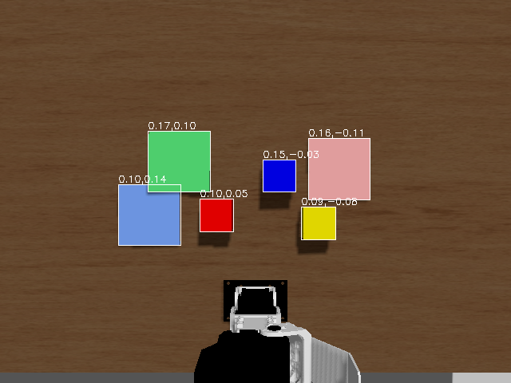

# AI×ロボティクス: 自然言語指示による CRANE+ V2 のピック&プレース

**LLM プランナーと閉ループ再計画による創造的タスクの実現（Physical AI応用1講座 最終課題）**

## 1. 課題の概要と目的

自然言語の指示（例:「赤いブロックを青いトレイに置いて」）だけで卓上アーム CRANE+ V2 にピック&プレースを行わせるシステムを、
講義環境（ROS 2 Humble + Ignition Gazebo Fortress）上に構築した。LLM（Claude）は指示を**サブゴール列**に翻訳する役割に限定し、
実際の運動は解析的な逆運動学（IK）で生成する。実行後に物体位置を再観測して目標未達なら LLM に**再計画**を求める閉ループ構成とし、
「曖昧な指示の解釈」と「人の妨害からの回復」まで一貫して動作することを目標にした。物体位置はシミュレータの真値ではなく、
テーブル上方の**カメラ画像**から色分割と逆投影で推定し、同じ構成が実機に移せることを示した。

目標とした指示レベルは次の4段階。

1. 物体名による指示（基本のピック&プレース）
2. 曖昧・条件付きの指示（「同じ色のトレイに」「色ごとに仕分けて」）
3. 実行中の妨害（人がブロックを動かす）からの自律的な回復
4. 到達不可能な指示の拒否（計画段階で「計画不可」を返す）

## 2. システム構成

図1: システム構成。実線は1回のタスクの流れ、破線は常時配信、赤は失敗時の再計画要求。

4つの ROS 2 ノード（Python, 計約500行）で構成する。

| ノード | 役割 | 主な入出力 |
|---|---|---|
| perception | 俯瞰カメラ画像（640×480, 約 4 Hz）から HSV 色分割で追跡対象（ブロック3個・トレイ3枚）を検出し、ピンホールモデルでロボット基準座標に逆投影して 2 Hz で配信。開発初期用に Gazebo 真値版も残す | `/overhead_camera/image` → `/perception/objects` (JSON), `/perception/debug_image` |
| planner | 指示文＋物体座標を Claude API に渡し、固定語彙 `move_to / grasp / release / home` のサブゴール列を JSON で受け取る。到達範囲チェックで不正な計画を弾く | `/task/instruction`, `/monitor/replan` → `/plan/subgoals` |
| controller | サブゴールを順に実行。`move_to` は4軸の解析IKで関節角に変換し `JointTrajectory` を送る | `/plan/subgoals` → `/crane_plus_*_controller/joint_trajectory`, `/controller/status` |
| monitor | 実行完了後に物体位置を再観測し、計画中の各「置き位置」に物体があるか判定。無ければ失敗理由を付けて再計画を要求（上限2回） | `/controller/status`, `/perception/objects` → `/monitor/replan`, `/monitor/result` |

使用技術: ROS 2 Humble, Ignition Gazebo Fortress（Gazebo Sim 6）, ros2_control（JointTrajectoryController）, crane_plus パッケージ,
Claude API（構造化出力 JSON Schema）, Python 3.10。開発は Windows 11 + WSL2 + Docker（講義配布イメージ）で行った。

### 2.1 Planner の設計

- **システムプロンプト**にロボットの座標系（x前方・y左・z上、テーブル面 z=0）、到達可能範囲（水平 0.06〜0.21 m, z 0〜0.15 m）、
  ブロック寸法、把持・設置の定型手順（上方へ→対象高さへ→把持→退避…）を記述し、物体一覧は毎回最新の座標を付けて送る。
- **構造化出力**（JSON Schema）で `action` を4語彙の enum に固定し、`target` は数値配列に限定。LLM の自由記述を実行系に流さない。
- 受け取った計画はコード側でも検証する（`move_to` の到達範囲、`target` の要素数）。違反時はエラー内容を添えて最大3回まで再要求。
- 到達範囲外などで実行不可能な場合は `subgoals` を空にして `error` に理由を書かせ、controller が拒否 → monitor が「計画不可」として最終結果に流す。
- 会話履歴（直近6往復）を保持し、「さっき置いた場所に戻して」のような参照指示や、再計画時の「前回は失敗した」という文脈を扱えるようにした。

### 2.2 Controller（IK）

CRANE+ V2 は旋回1軸＋ピッチ3軸の構成なので、把持点 (x, y, z) と手先の鉛直姿勢（グリッパを真下に向ける）を与えれば
解析的に関節角が決まる。URDF のリンク長（肩高さ 0.0714, 上腕 0.083, 前腕 0.0935, 把持点までの手先長 0.11 m）と、
Gazebo で実測した関節の向き（joint2 は正で前傾、joint3・4 は正で後傾）を用いた。手先姿勢が真下で解けない遠方では、
手先の傾きを少しずつ緩めて解を探索する。軌道の所要時間は関節の最大移動量から決め（0.5 rad/s, 下限 2.0 s）、
大きな旋回ほどゆっくり動かして把持中の滑落を防ぐ。次の指令はシミュレーション時刻で完了を待ってから送る。
CRANE+ のグリッパは片側の指だけが動くため、閉じた物体は固定指側へ押し付けられ、物体中心が把持点から接線方向に約 1.2 cm ずれる
（5.4 節）。把持中はこのずれ分だけ旋回角を戻して置き位置を補正する。

### 2.3 Perception（カメラ）

テーブル面の 0.70 m 上に真下向きの固定カメラ（水平画角 0.9 rad）を置き、画像だけから物体位置を推定する（図3）。

1. HSV に変換し、物体クラスごとの色範囲でマスクを作る。ブロック（純色, 彩度≈255）とトレイ（淡色, 彩度 75〜160）は
   同系色でも**彩度**で分ける。木目のテーブル（色相 13〜14）は赤（≤6）と黄（≥20）の間に入れない。
2. 連結成分ごとに面積で小さなノイズを捨て、ブロックは重心、トレイは外接矩形の中心を使う（上にブロックが載って一部が隠れても
   矩形の中心は動きにくい。矩形内に中心があるブロックの矩形は取り込む）。
3. 画素座標を、物体上面の高さの平面（ブロック 4 cm, トレイ 0.5 cm）へピンホールモデルで逆投影し、ロボット基準座標に変換する。

真値との誤差は 6 物体すべてで 2 mm 以内（`scripts/check_camera.py` で計測）。出力トピックと JSON の形式は真値版と同じなので、
planner / monitor は変更なしで切り替えられる。

図3: 俯瞰カメラ画像と検出結果（白枠と推定座標）。左下の黒い部分はロボット本体。

### 2.4 Monitor（閉ループ）

計画中の `grasp` の後に続く `release` の直前の `move_to` 座標を「置き位置」とみなし、実行完了の 1.5 s 後に
その水平 3.5 cm 以内（トレイ半幅 4 cm より内側）に運搬対象の物体があれば成功と判定する。トレイ自身は判定対象から外し、
1つの物体が複数の置き位置を満たすことは認めない。
失敗時は「置き位置 (x, y) に物体がありません。把持失敗または落下の可能性」という自然言語の理由を planner に送り、
planner は最新の物体座標でもう一度計画する。これにより「把持がすべった」「人がブロックを動かした」の両方に同じ仕組みで対応できる。

## 3. 工夫した点

1. **LLM を制御ループの外に置くイベント駆動設計**。LLM 呼び出し（平均 8 秒）は指示受付時と失敗時だけで、運動制御は ROS 2 側で完結する。
   LLM の遅延やゆらぎが制御周期に影響しない。
2. **安全層の二重化**。JSON Schema による語彙固定と、コードによる到達範囲チェックで、物理的に不可能な計画を実行前に弾く。
   実行不可能な指示（例: 到達範囲外のトレイ）は「計画不可」として理由付きで返す。
3. **自然言語で閉じる再計画ループ**。monitor の失敗理由をそのまま LLM への入力にしたため、失敗の種類ごとの分岐ロジックを書かずに済んだ。
4. **曖昧指示の解釈を LLM に委ねつつ根拠を残す**。各サブゴールの `note` に解釈の根拠を書かせ（「赤いトレイが無いため緑へ」など）、
   ログと動画の字幕で判断過程を追えるようにした。
5. **知覚を画像ベースに置き換え、真値に依存しない**。俯瞰カメラの色分割＋逆投影で物体座標を得る perception を実装し、
   以降の評価とデモはすべてこの知覚で行った。perception の差し替えだけで済む設計の検証にもなっている。
6. **録画・検証・評価の自動化**。ワールドのリセット、録画、指示送信、妨害（把持後に物体を瞬間移動）、結果待ち、イベント時刻に基づく字幕生成、
   4 種のデモを繰り返す無人評価（成功率・再計画回数・LLM 統計の集計）をスクリプト化し、Claude Code からの反復実験を可能にした。
   繰り返し評価で見つかった失敗要因（5.4 節）を一つずつ潰して成功率を上げた。

## 4. デモ内容（動画の構成）

1. 構成説明（図）
2. 基本:「赤いブロックを青いトレイに置いて」— 11ステップの計画 → 実行 → monitor が配置を確認
3. 曖昧指示:「青いブロックを同じ色のトレイに置いて」— 物体一覧から青いトレイを選択
4. 仕分け:「ブロックを色ごとに同じ色のトレイに仕分けて」— 赤→赤トレイ、青→青トレイ。黄色は対応するトレイが無いので残すと判断
5. 妨害からの回復:「赤いブロックを緑のトレイに置いて」の把持直後にブロックを別の場所へ移動 → 置き位置に物体なし → 再計画 → 成功
6. 工夫点と今後の発展

動画は一部 2 倍速（画面に明記）。画面上部に指示文、下部に各ノードの状態（計画中・実行中・妨害・再計画・完了）を字幕で表示し、
右下にカメラ知覚の検出結果を小窓で重ねる。

図2: デモ動画のコマ。左: 基本ピック&プレース（実行中）、右: 妨害後に monitor が「置き位置に物体なし」を検知して再計画を要求。

## 5. 結果と考察

### 5.1 デモの結果（10/30 録画分, カメラ知覚）

| デモ | 計画ステップ数 | 再計画 | 実行時間（指示→完了） | 結果 |
|---|---|---|---|---|
| 基本 | 11 | 0 | 54 s | 成功 |
| 曖昧指示 | 11 | 0 | 56 s | 成功（青トレイを選択） |
| 仕分け（3ブロック） | 19 | 0 | 99 s | 成功（2配置、黄色は対象外と判断） |
| 妨害からの回復 | 11 + 11 | 1 | 108 s | 成功 |

### 5.2 繰り返し評価（4 デモ × 5 回, 無人）

`scripts/eval_batch.sh` で各デモを 5 回ずつ、ワールドをリセットしながら録画なしで実行した。
下表は最終構成（カメラ知覚、設置高さ 3.5 cm、片側指と手先傾きの補正あり）の結果。

| デモ | 試行 | 成功 | 所要時間 平均（最小–最大） | 再計画 平均 | LLM 呼出 平均 | 計画時間 平均 |
|---|---|---|---|---|---|---|
| 基本 | 5 | 4（＋1 無効試行） | 55 s（52–66） | 0.0 | 1.0 | 5.1 s |
| 曖昧指示 | 5 | 5 | 58 s（54–66） | 0.0 | 1.0 | 6.5 s |
| 仕分け | 5 | 5 | 94 s（90–105） | 0.0 | 1.0 | 8.8 s |
| 妨害からの回復 | 5 | 5 | 105 s（101–117） | 1.0 | 2.0 | 5.9 s |

20 試行中 19 成功。基本デモの 1 回は指示トピックの配信が planner に届かず（LLM 呼び出し 0 回、タイムアウト）、
システムの失敗ではなく試験装置側の取りこぼしだった。これを除く 19 試行はすべて成功し、妨害復帰以外では再計画も発生していない。
指示送信は以後 2 回送って planner 側で重複を捨てる方式に変更した。

改善前の構成（Gazebo 真値知覚、初期配置・補正なし）では 20 試行中 19 成功と記録されたが、
うち妨害復帰の 1 回は monitor がトレイ自身を「置かれた物体」と誤認した偽の成功で、実際は 18/20（90%）だった。
カメラ知覚に切り替えた直後（補正なし）は 20 試行中 18 成功だが基本デモの 5 回中 2 回で再計画が必要になり、
置き位置のずれが主因だった。置き位置の誤差（真値で計測）は補正前の 1.3〜3.8 cm から補正後は全トレイで 0.5〜1.3 cm に縮まった。

### 5.3 LLM 呼び出しの統計（開発期間中の全 178 回）

| 項目 | 値 |
|---|---|
| 計画生成時間 | 平均 7.8 s（4.1〜15.9 s, 評価 99 回分） |
| 入力トークン | 平均 4,050（1,050〜6,700。会話履歴 6 往復を含む） |
| 出力トークン | 平均 610（70〜2,220） |
| 計画のステップ数 | 1物体 10〜13、3物体 19〜30 |
| スキーマ違反・到達範囲違反による再要求 | 開発初期に数回。現在のプロンプトでは発生していない |

### 5.4 繰り返し評価で判明した失敗要因と対処

- **初期配置の傾き**: 赤ブロックの初期位置 (0.12, 0.06) は緑トレイ（8 cm 角, 厚さ 5 mm）の角に 1 cm 重なっており、
  リセットのたびに約 22° 傾いて静止していた。傾いたブロックは把持が浅く、62° の旋回中に滑落して隣のブロックの横に落ち、
  次の把持も妨げた（仕分けデモの失敗要因）。初期位置を (0.10, 0.05) に変更。
- **monitor がトレイを物体と誤認**: 置き位置の 3 cm 以内にある「物体」としてトレイ自身が合致し、ブロックが到達範囲外へ弾かれた
  試行が成功と判定されていた。運搬対象だけを判定に使うよう修正。
- **同色のブロックとトレイが繋がる**: 面積でブロックとトレイを分けていたため、青ブロックが青トレイに載ると一つの青い塊になり
  ブロックを見失った。彩度（純色 255 / 淡色 75〜160）で分けて解決。
- **置き位置の系統誤差**: 関節の追従は正確（指令と実測の差 < 0.01 rad）なのに、置いたブロックが目標から接線方向に 1.2〜3.4 cm
  ずれた。CRANE+ のグリッパは片側の指だけが動き、閉じると物体が固定指側へ押し付けられるためで、把持中は旋回角をその分戻す補正を入れた。
  さらに遠いトレイ（水平 0.19 m）では手先が 30° 傾いた状態で離すためブロックが外側へ転がり、設置高さを 3.5 cm に下げ、
  傾き角に応じて置き位置を手前に寄せる補正を加えた。
- **到達範囲ぎりぎりでの拒否**: 妨害や滑落でブロックが水平 0.21 m 以遠へ行くと planner が「計画不可」を返す。
  これは設計どおりの振る舞いだが、再計画で救えない失敗の主因として残っている。

開発中に判明した要因（設置時にグリッパがトレイを押す → 設置高さとトレイ質量の変更、LLM が `error` 欄に解釈の根拠を書く →
`subgoals` 非空なら無視、録画中の RTF 低下 → `use_sim_time`、妨害のタイミング → 把持完了を待って 2 秒後）も同様にスクリプト化した
反復実験で潰した。

### 5.5 考察

- LLM に「何をどの順で」だけを決めさせ、「どう動くか」は IK と ros2_control に任せる分担は、小さな4軸アームでも安定して動いた。
  計画の失敗はほぼ物理側（把持ずれ・接触）で起き、それは monitor の再計画で吸収できた。
- 曖昧な指示（同じ色・色ごと・対応するトレイが無い場合）の解釈は、物体一覧を座標付きで渡すだけでプロンプト個別対応なしに成立した。
- 知覚を真値からカメラ画像に替えても planner / monitor は無変更で動き、成功率も変わらなかった。環境が整った状況では
  古典的な色分割で十分で、LLM/VLM は「意味の解釈」に集中させるのが費用対効果が高い。
- 一方で LLM の応答時間（平均 8 秒）は実機の対話的操作には長い。指示の受付時だけに限定している現設計でも、
  再計画が重なると 1 タスク 1.5〜2 分になる。より小さいモデルや計画のキャッシュが実用上は必要。
- monitor の判定は「置き位置に運搬対象があるか」だけで、物体の同一性は見ていない。隣のブロックを巻き込んだ場合に誤判定しうる。
- 繰り返し評価は、1 回のデモでは見えない系統誤差（片側指のずれ、初期配置の傾き）を浮かび上がらせた。
  「動いた」で止めず回数を重ねることが、物理系では設計の検証そのものだった。
- 実運用で重要なのは成功率そのものより「失敗に気づけるか」である。LLM も学習モデルも、知らない状況では確信を持って誤る。
  本システムでは planner が実行不可能な指示を理由付きで拒否し（計画段階の検知）、monitor が結果を観測で確認して再計画し
  （実行後の検知）、上限に達したら理由を添えて停止する。モデルの出力を信用せず観測で裏を取るこの構えは、
  将来 controller に学習モデルを入れても外側のループとして残すべきものである。

## 6. 反省点・今後の発展

- **知覚の一般化**: 現在の色分割は既知の色・形に限る。カメラ画像を VLM に渡して任意の物体名と位置を得る構成にすれば、
  「ペンをカップに」のような未知物体の指示にも同じアーキテクチャで対応できる。実機ではカメラ外部パラメータの校正も必要になる。
- **世界モデル＋MPC による Controller の置き換え**: 現在の controller は固定の定型動作で、接触や滑りに対して開ループである。
  本タスクは剛体把持なので解析モデルで足りたが、片側指による 1.2 cm のずれのように URDF からは予測できず実測で初めて分かる
  挙動があった。こうした機体固有の誤差や、布・袋物のように物理モデルを書けない対象では、実データから学習した動力学モデルで
  短期の結果を予測しながら動作を選ぶ MPC が有効になる。把持ずれを monitor の再計画に頼らず動作中に補正できる。
  ただし学習モデルは学習範囲外の対象で確信を持って誤るため、予測のばらつき（アンサンブル等）で不確かさを測り、
  大きければ減速や人への引き継ぎに切り替える仕組みと、観測で結果を確認する monitor のループは残す必要がある。
- **非把持操作への移植**: 同じ planner / monitor 構成を toio（押し運び, Push-T 相当）に適用し、「把持できない物体を運ぶ」タスクに広げる。
- **監視の高度化**: 実行中の物体追跡と「握っているはずの物体が手元に無い」検知で、完了を待たずに再計画を始める。
- **評価の拡充**: 本レポートの繰り返し評価は固定配置・固定指示。配置と指示文をランダム化した試行で汎化性を測る。

## 付録: リポジトリ構成

- `ros2_ws/src/pai_llm_arm/`: 提出対象パッケージ（5ノード = 4役割＋真値版 perception、launch、俯瞰カメラ付きワールド、パラメータ、録画向け GUI 設定）
- `scripts/`: ワールド配置・ノード起動・指示送信・妨害・録画・字幕生成・繰り返し評価の補助スクリプト
- `docs/`: 本資料、引き継ぎメモ、スケジュール
- API キーは環境変数 `ANTHROPIC_API_KEY` のみで扱い、リポジトリには含めない。
